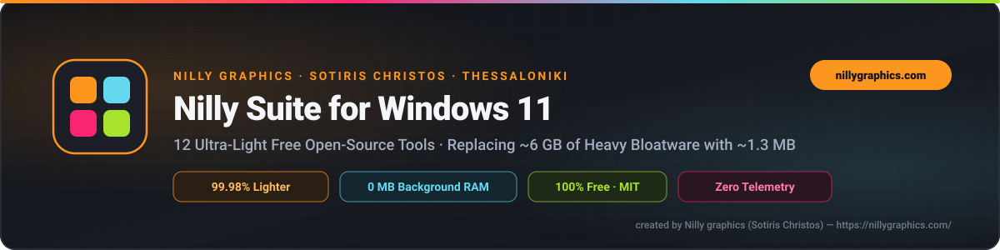

  

  
  
  
  
  

---

### One Launcher. 11 Native Windows 11 Tools. **99.98% Lighter.**

**Nilly Suite** is a free, open-source (MIT) collection of **11 ultra-lightweight Windows 10/11 desktop & creative tools** built by **[Nilly graphics (Sotiris Christos)](https://nillygraphics.com/)** in Thessaloniki, Greece — engineered to replace **~6 GB of heavy bloatware** with **1.24 MiB** of pure native speed, **0 MB background RAM**, **zero Electron**, **zero telemetry**, and **zero admin rights**.

> **Ελληνικά:** Η **Nilly Suite** είναι μια 100% δωρεάν (0€, MIT) σουίτα **11 πανάλαφρων εργαλείων για Windows 10/11** από τη **[Nilly graphics (Sotiris Christos)](https://nillygraphics.com/)**. Αντικαθιστά **~6 GB βαριών εφαρμογών** σε μόλις **1,24 MiB (99,98% πιο ελαφριά)** με **0 MB RAM στο παρασκήνιο**, χωρίς συνδρομές και χωρίς παρακολούθηση.

---

### Start Here — Install Everything in 1 Click with **NillyHub**

| Launcher | Size | What It Does | Official Links |
| :--- | :---: | :--- | :--- |
| **[NillyHub](https://github.com/nillynp/nillyhub)** | **~80 KB** | All-in-one native launcher & **SHA-256 verified auto-updater** for all 11 Nilly Suite tools (ETag 304 cache, atomic rollback, 1-click full suite install, zero admin). | [Download Latest Release](https://github.com/nillynp/nillyhub/releases/latest) · [nillygraphics.com (0€)](https://nillygraphics.com/product/nillyhub/el/) |

---

### Complete 12-Tool Nilly Suite Ecosystem (0€ · MIT · Windows 10/11)

| Tool | Category | Replaces (Typical Size) | Nilly Size | GitHub Repo | Official Page (`0€`) |
| :--- | :--- | :--- | :---: | :---: | :---: |
| **[NillyZip Pro](https://github.com/nillynp/nillyzip-pro)** | Native Archive Manager (ZIP, RAR, 7Z, TAR, XZ, ZST + Preview & SHA-256) | WinRAR / 7-Zip / PeaZip (11–120 MB) | **~45 KB ZIP** | [nillyzip-pro](https://github.com/nillynp/nillyzip-pro) | [nillygraphics.com](https://nillygraphics.com/) |
| **[NillyDoc Pro](https://github.com/nillynp/nillydoc-pro)** | PDF Viewer, Inline Editor & Mobile PWA | Adobe Acrobat Pro (~2.5 GB) / PDFgear (394 MB) | **~659 KB ZIP** | [nillydoc-pro](https://github.com/nillynp/nillydoc-pro) | [nillygraphics.com](https://nillygraphics.com/product/nillydoc-pro-windows/el/) |
| **[NillyView Pro](https://github.com/nillynp/nillyview-pro)** | 65+ Format Image, Camera RAW, PSD & Affinity Viewer | Windows Photos (881 MB) & Paint (417 MB) | **~62 KB ZIP** | [nillyview-pro](https://github.com/nillynp/nillyview-pro) | [nillygraphics.com](https://nillygraphics.com/product/nillyview-pro/el/) |
| **[NillyBatch Pro](https://github.com/nillynp/nillybatch-pro)** | Bulk Image Resize, WebP, Watermark & Greeklish SEO Renamer | Adobe Bridge (~1.95 GB) | **~78 KB ZIP** | [nillybatch-pro](https://github.com/nillynp/nillybatch-pro) | [nillygraphics.com](https://nillygraphics.com/product/nillybatch-pro/el/) |
| **[NillyQuickSnap](https://github.com/nillynp/nillyquicksnap)** | Instant Screenshot, Live Pixel Ruler, Blur & Annotation | Windows Snipping Tool (533 MB) | **~34 KB ZIP** | [nillyquicksnap](https://github.com/nillynp/nillyquicksnap) | [nillygraphics.com](https://nillygraphics.com/product/nillyquicksnap/el/) |
| **[NillyCalc Pro](https://github.com/nillynp/nillycalc-pro)** | Graphic Designer Calculator (DPI, CMYK, Eyedropper, VAT, m²) | Windows Calculator (18 MB) | **~81 KB ZIP** | [nillycalc-pro](https://github.com/nillynp/nillycalc-pro) | [nillygraphics.com](https://nillygraphics.com/product/nillycalc-pro/el/) |
| **[NillyCode Pro](https://github.com/nillynp/nillycode-pro)** | Sublime-Style Monokai Code Editor with Minimap & Diff | Sublime Text / Heavy IDEs (~58+ MB) | **~52 KB ZIP** | [nillycode-pro](https://github.com/nillynp/nillycode-pro) | [nillygraphics.com](https://nillygraphics.com/product/nillycode-pro/el/) |
| **[NillyNote Pro](https://github.com/nillynp/nillynote-pro)** | Tabbed Windows 11 Notepad with Auto-Session & Dark UI | Windows Notepad (18 MB) | **~40 KB ZIP** | [nillynote-pro](https://github.com/nillynp/nillynote-pro) | [nillygraphics.com](https://nillygraphics.com/product/nillynote-pro/el/) |
| **[NillyMedia Lite](https://github.com/nillynp/nillymedia-lite)** | Instant Video/Audio Player & 1-Click Lossless WAV Recorder | Windows Media Player & Sound Recorder (46 MB) | **~33 KB ZIP** | [nillymedia-lite](https://github.com/nillynp/nillymedia-lite) | [nillygraphics.com](https://nillygraphics.com/product/nillymedia-lite/el/) |
| **[NillyDisk Pro](https://github.com/nillynp/nillydisk-pro)** | Visual Disk Treemap, SHA-256 Duplicate Finder & Cleaner | TreeSize / WinDirStat (~40 MB) | **~44 KB ZIP** | [nillydisk-pro](https://github.com/nillynp/nillydisk-pro) | [nillygraphics.com](https://nillygraphics.com/product/nillydisk-pro/el/) |
| **[NillyClip Pro](https://github.com/nillynp/nillyclip-pro)** | Local Clipboard History & Encrypted Private Vault | Cloud Clipboard Managers | **~38 KB ZIP** | [nillyclip-pro](https://github.com/nillynp/nillyclip-pro) | [nillygraphics.com](https://nillygraphics.com/product/nillyclip-pro/el/) |
| **[Nilly PC Manager & Tools](https://github.com/nillynp/nilly-pc-manager-tools)** | All-in-One Studio Maintenance, Cleaner, DNS & Gamepad Tester | Heavy PC Optimizers & Store Utilities | **~153 KB ZIP** | [nilly-pc-manager-tools](https://github.com/nillynp/nilly-pc-manager-tools) | [nillygraphics.com](https://nillygraphics.com/product/nilly-pc-manager-tools/el/) |

---

### Why Nilly Suite?

- **99.98% Smaller Footprint:** All **11 portable ZIP archives combined total 1.24 MiB** vs **~6 GB** of standard heavy apps.
- **0 MB Background RAM:** Nothing runs silently at startup, no background daemons, no forced cloud updaters.
- **100% Local & Private:** Your PDFs, RAW photos, clipboard vault, and client files never leave your computer (0 external CDNs, 0 analytics, 0 ads).
- **Verified Security:** Every portable release is verified by **SHA-256 digest** and continuously tested end-to-end on Windows via GitHub Actions CI.
- **Zero Admin Required:** Portable per-user (`HKCU`) installs — works cleanly on any Windows 10/11 PC.

---

### Creative Studio & Digital Services — **Nilly graphics (Sotiris Christos)**

Beyond open-source Windows utilities, **[Nilly graphics](https://nillygraphics.com/)** is an independent Graphic Design & Web Studio based in **Thessaloniki, Greece**:

- **Logo Design & Brand Identity** *(Σχεδιασμός Λογοτύπου & Εταιρικής Ταυτότητας)*
- **Print, Packaging & Prepress Production** *(Έντυπα, Συσκευασία & Προεκτύπωση CMYK)*
- **Web Design, WordPress & WooCommerce** *(Κατασκευή Ιστοσελίδων & E-shop)*
- **Free Creative Tools & Resources (0€)** → **[nillygraphics.com](https://nillygraphics.com/)**

---

  <strong>created by <a href="https://nillygraphics.com/">Nilly graphics (Sotiris Christos)</a> — <a href="https://nillygraphics.com/">https://nillygraphics.com/</a></strong>

